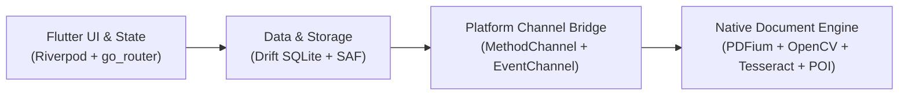

# Document Reviewer

[](#)
[](https://flutter.dev)
[](https://developer.android.com)
[](#)
[](#)
[](https://pub.dev/packages/very_good_analysis)

**Document Reviewer** is an offline-first, privacy-respecting document viewer, annotator, and editor built for Android. It operates with zero network requirements, zero analytics, no advertisements, and no user accounts—delivering total data sovereignty for viewing and modifying sensitive documents directly on-device.

---

## Key Features (Planned)

- **Multi-Format Document Reading**: Fast, high-fidelity rendering for PDF, Microsoft Office (`DOCX`, `XLSX`, `PPTX`), OpenDocument (`ODT`, `ODS`, `ODP`), plain/rich text (`TXT`, `RTF`, `CSV`), and raster images (`JPEG`, `PNG`, `TIFF`, `BMP`, `WEBP`).
- **PDF Annotation Suite**: Highlighting, underline, strikeout, sticky notes, geometric shapes, and freehand ink drawing with palm rejection and stylus pressure sensitivity.
- **Digital Signatures**: Secure local vector signature pad to sign documents on the go without cloud telemetry.
- **Office Document Editing**: In-place editing for Word documents and spreadsheets with atomic save guarantees.
- **Mobile Document Scanner**: Real-time camera viewfinder with OpenCV edge detection, automatic quadrilateral perspective correction, and shadow-removal filters.
- **On-Device OCR**: Offline text recognition powered by Tesseract OCR v5 with bundled Indonesian (`ind`) and English (`eng`) language packs; export to searchable sandwich PDFs.
- **Storage Access Framework (SAF)**: Deep Android Scoped Storage integration supporting persistable URI permissions without requiring invasive broad file system access.
- **Atomic Edit Verification Cycle**: Protects against document corruption by staging mutations in an isolated scratch sandbox and validating structure before committing changes.

---

## Architecture Overview

Document Reviewer pairs a declarative Flutter frontend with high-performance native Android processing engines via an event-driven platform channel bridge.



- **Presentation Layer**: Built with Flutter 3.24+, using `flutter_riverpod` (code-generated with `riverpod_generator`) for state management and `go_router` for deep linking and navigation.
- **Domain & Data Layer**: `freezed` for immutable value objects, `drift` with SQLite for caching recents and bookmarks, and custom SAF managers for file operations.
- **Platform Layer (`android/document_engine`)**: Modular Kotlin/C++ engine exposing abstract contracts:
  - `DocumentReaderEngine`
  - `PdfAnnotationEngine`
  - `OfficeEditorEngine`
  - `OcrEngine`
  - `DocumentScannerEngine`

For detailed technical designs, consult [docs/ARCHITECTURE.md](docs/ARCHITECTURE.md).

---

## Project Structure

```
.
├── android/
│   ├── app/                    # Flutter Android application runner
│   └── document_engine/        # Native Kotlin/C++ document processing module
├── assets/
│   ├── fonts/                  # Custom typography
│   ├── icons/                  # Application vectors and launcher icons
│   └── licenses/               # Bundled third-party license notices
├── docs/                       # Project documentation and specifications
│   ├── ARCHITECTURE.md         # Layer diagrams, data flow, threading, and SAF lifecycle
│   ├── FORMAT_SUPPORT.md       # Capability matrix and edit verification rules
│   ├── LICENSE_AUDIT.md        # Dependency compliance tracking
│   ├── PRODUCT_SPEC.md         # Product vision, user personas, and feature specs
│   ├── SPIKE_PLAN.md           # Phase 1 technical spike evaluations
│   ├── TEST_PLAN.md            # Unit, widget, integration, and performance test plans
│   └── THIRD_PARTY_NOTICES.md  # Open-source attributions and license texts
├── lib/
│   ├── app/                    # App entry points, theme config, and observers
│   ├── core/                   # Engine contracts, constants, and error definitions
│   ├── data/                   # Drift SQLite database, DAOs, and SAF persistence
│   ├── features/               # Feature-first modular packages
│   └── shared/                 # Reusable UI components and helper utilities
├── spikes/                     # Isolated prototypes for engine spikes
└── test/                       # Unit, widget, and integration test suites
```

---

## Getting Started

### Prerequisites

Ensure your development environment meets the following specifications:
- **Flutter SDK**: `^3.24.0` (Dart SDK `^3.5.4`)
- **Android SDK**: Compile SDK `35` / `36`, Minimum SDK `26` (Android 8.0 Oreo)
- **Java Development Kit**: JDK 17 (recommended: Eclipse Temurin or Azul Zulu 17)
- **Android NDK**: Version `25.x` or newer (for building native C++ dependencies)
- **Target Architecture**: Android `arm64-v8a` (physical devices) or `x86_64` (emulator)

### Setup & Installation

1. **Clone the repository**:
   ```bash
   git clone https://github.com/example/document_reviewer.git
   cd document_reviewer
   ```

2. **Install Flutter dependencies**:
   ```bash
   flutter pub get
   ```

3. **Run code generation**:
   Generate Drift database classes, Riverpod providers, and Freezed models:
   ```bash
   dart run build_runner build --delete-conflicting-outputs
   ```

4. **Verify static analysis**:
   ```bash
   flutter analyze
   ```

5. **Run test suite**:
   ```bash
   flutter test
   ```

---

## Building

### Debug Build
```bash
flutter build apk --debug
```

### Release Build (Targeting arm64-v8a)
```bash
flutter build apk --release --target-platform android-arm64 --split-per-abi
```

The resulting APK will be located at:
`build/app/outputs/flutter-apk/app-arm64-v8a-release.apk`

---

## Contributing

We welcome contributions that respect the core tenets of the project (offline-first, zero trackers, atomic document integrity).

1. Review the [Product Specification](docs/PRODUCT_SPEC.md) and [Architecture Guide](docs/ARCHITECTURE.md).
2. Ensure any new dependencies comply with the [License Audit Policy](docs/LICENSE_AUDIT.md) (permissive licenses only: MIT, BSD, Apache-2.0).
3. Follow the [Test Plan](docs/TEST_PLAN.md) and provide comprehensive unit/widget tests for new features.
4. Ensure code passes all strict lint rules:
   ```bash
   dart run very_good_analysis analyze
   ```

---

## License

License terms are currently **TBD** (to be determined). All current third-party libraries and code assets are tracked in [docs/THIRD_PARTY_NOTICES.md](docs/THIRD_PARTY_NOTICES.md).
