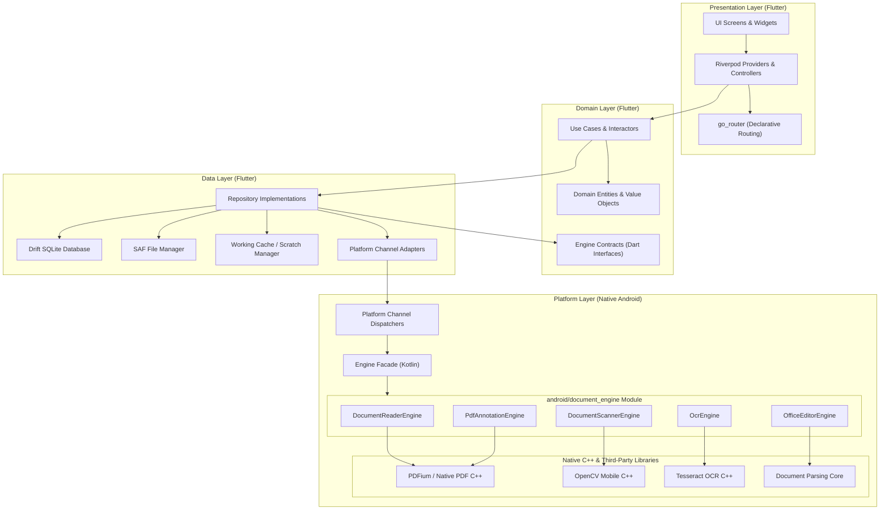
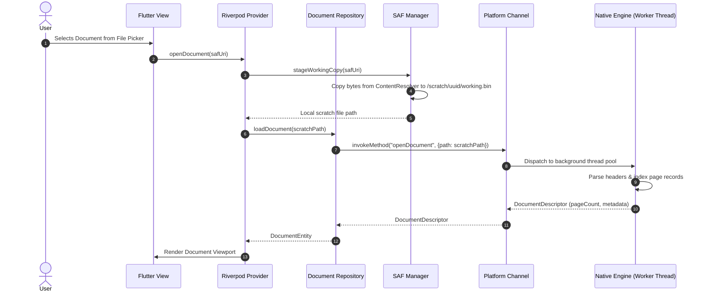
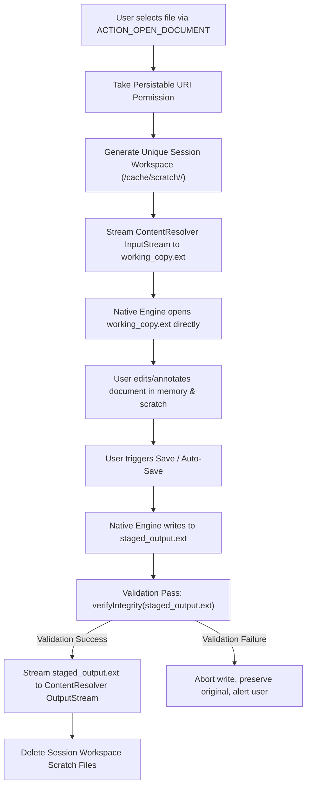

# Document Reviewer — System Architecture

## 1. Overview & Architectural Principles

**Document Reviewer** uses a layered, offline-first architecture separating declarative UI components in Flutter from compute-heavy document processing engines in Android native code.

### Architectural Tenets
- **Separation of Concerns**: Strict boundary separation across Presentation, Domain, Data, and Platform layers.
- **Unidirectional Data Flow**: State flows down from providers to UI widgets; user events bubble up through providers to repositories.
- **Fail-Safe File Operations**: Zero in-place overwrites without prior validation. File operations use atomic staging in sandboxed working directories.
- **Off-Main-Thread Execution**: All disk I/O, SQLite operations, parsing, rendering, and computer vision algorithms are quarantined to Dart background isolates or native worker threads.

### 1.1 Universal Android Compatibility Standards (Mandatory Across All Phases)
1. **SDK Targets**: `minSdk 26` (Android 8.0 Oreo), `targetSdk` / `compileSdk` latest (API 34/36). Test across API 26, 30, 34, and latest.
2. **Supported ABIs**: `arm64-v8a` (primary), `armeabi-v7a` (legacy devices), `x86_64` (emulator). All bundled native libraries must support these ABIs.
3. **16 KB Memory Page Size Compatibility**: Mandatory for Android 15+. Every native `.so` must be verified for 16 KB ELF page alignment and documented in `LICENSE_AUDIT.md` and `SPIKE_REPORT.md`.
4. **Adaptive UI Layout**: First-class responsiveness for small screens ($\le$ 360dp), large phones, tablets, foldables, landscape orientation, multi-window / split-screen, and configuration changes (system font scaling up to 200%, dark/light mode toggle).
5. **Low-RAM (2 GB / Android Go) Optimization**: Avoid loading entire documents into memory. Enforce windowed paging, bounded image/tile caching, memory-mapped files, and background isolate processing.
6. **Scoped Storage & SAF**: Exclusively use Storage Access Framework and Android Photo Picker. Zero requests for broad storage permissions (`MANAGE_EXTERNAL_STORAGE`). Resilient handling of local, SD-card, and cloud-backed SAF content URIs.
7. **Modern System Behaviors**: Edge-to-edge drawing, predictive back navigation gesture, runtime notification permissions, background execution limits, and process-death state restoration.
8. **Accessibility (a11y)**: Screen reader (TalkBack) semantic labels, WCAG AA color contrast, minimum touch target size $\ge 48\times 48\text{ dp}$, font scaling resilience up to 200%.
9. **Localization (i18n / l10n)**: Bilingual support (Bahasa Indonesia & English) with locale-aware date, time, and numeric formatting.
10. **Zero Ad / Telemetry / Offline Guarantee**: 100% local execution. No analytics SDKs, no trackers, no user accounts, no mandatory internet connectivity.
11. **Verification Discipline**: Strictly distinguish between *"sudah dijalankan dan lulus"* vs *"diasumsikan"*. Document all dependencies in `LICENSE_AUDIT.md`.


---

## 2. Layer Diagram



---

## 3. Flutter Layer Architecture

### 3.1 Feature-First Directory Structure
The codebase follows a feature-driven packaging structure where each functional domain encapsulates its own presentation, domain, and data components:

```
lib/
├── app/                  # Application bootstrap, app-level widgets, global themes
├── core/                 # Shared infrastructural logic, base classes, utilities
│   ├── constants/        # System configuration, route names, constants
│   ├── engine/           # Abstract engine contracts (Dart interfaces)
│   └── error/            # Unified exception handling and failure models
├── data/                 # Global data services
│   ├── database/         # Drift SQLite database schema and DAOs
│   ├── repository/       # Shared repository implementations
│   └── saf/              # Storage Access Framework helpers & URI persistency
├── features/             # Modular feature packages
│   ├── backup_restore/
│   ├── document_reader/  # PDF & Office viewer UI, controllers, and state
│   ├── export/           # Document conversion and print dispatch
│   ├── file_manager/     # Document browser, SAF pickers, recents, tags
│   ├── home/             # Dashboard, quick actions, recent files
│   ├── ocr/              # OCR processing queue and preview
│   ├── pdf_tools/        # Merge, split, page reordering, compression
│   ├── scanner/          # Camera viewfinder, quad-cropping, image filters
│   ├── settings/         # App preferences, theme selection, diagnostics
│   ├── spreadsheet_editor/ # XLSX grid editor, formula bar, cell state
│   └── word_editor/      # DOCX text editor, formatting toolbar
└── shared/               # Reusable widgets, formatters, and extensions
```

### 3.2 State Management: Riverpod (Code Generation)
- **Code Generation**: Utilizing `riverpod_annotation` and `riverpod_generator` (`@riverpod`) for compile-time safe, boilerplate-free dependency injection.
- **State Types**:
  - `AsyncNotifier<T>`: Used for asynchronous document state, file loading, and database sync.
  - `Notifier<T>`: Used for synchronous UI states (e.g., active tool selection, zoom level, toolbar visibility).
  - `AutoDispose`: All document-specific providers automatically dispose memory, bitmaps, and temporary file handles when the user navigates away from the viewer or editor.
- **Immutability**: Document model state is governed by `freezed` classes ensuring immutable transitions and pattern-matching evaluation.

### 3.3 Routing: `go_router`
- Declarative route management featuring type-safe routing parameters.
- Deep-linking and system intent routing: Captures Android `ACTION_VIEW` intents when the user opens documents from external file managers.
- Shell routing for unified navigation rails across tablets and bottom navigation across mobile form factors.

### 3.4 Local Persistence: Drift (SQLite)
- Type-safe, reactive SQLite database powered by `drift` and `sqlite3_flutter_libs`.
- **Primary Entities**:
  - `RecentFiles`: Tracks persistable SAF URIs, file names, mime types, file sizes, last opened timestamps, and cached thumbnail paths.
  - `Bookmarks`: Stores page indices, timestamps, and user labels per document URI.
  - `AnnotationDrafts`: Serializes local annotation layers prior to committing them permanently to the underlying file.
  - `OcrJobs`: Tracks background OCR processing state, detected text blocks, and confidence scores.

---

## 4. Native Layer Architecture (`android/document_engine`)

The native document processing subsystem is decoupled from the main Flutter Android harness into a standalone Gradle library module located at `android/document_engine`.

### 4.1 Engine Interfaces (Kotlin Contracts)

All native processing capabilities are exposed through strict object-oriented interfaces:

```kotlin
// 1. Document Reader Engine
interface DocumentReaderEngine {
    fun openDocument(filePath: String, password: String?): DocumentDescriptor
    fun getPageCount(): Int
    fun renderPageToBitmap(pageIndex: Int, targetWidth: Int, targetHeight: Int): Bitmap
    fun getDocumentOutline(): List<OutlineNode>
    fun extractPageText(pageIndex: Int): String
    fun closeDocument()
}

// 2. PDF Annotation Engine
interface PdfAnnotationEngine {
    fun loadAnnotations(filePath: String): List<AnnotationObject>
    fun addHighlight(pageIndex: Int, bounds: List<RectF>, color: Int)
    fun addInkStroke(pageIndex: Int, points: List<PointF>, strokeWidth: Float, color: Int)
    fun addSignature(pageIndex: Int, signaturePng: ByteArray, targetRect: RectF)
    fun addStickyNote(pageIndex: Int, position: PointF, content: String)
    fun saveWithAnnotations(destinationPath: String): Boolean
}

// 3. Office Editor Engine
interface OfficeEditorEngine {
    fun loadDocument(filePath: String): OfficeModel
    fun updateParagraphText(paragraphId: String, newText: String, styles: StyleConfig)
    fun updateSpreadsheetCell(sheetIndex: Int, row: Int, col: Int, rawValue: String, formula: String?)
    fun addTableRow(tableId: String, rowIndex: Int)
    fun commitChanges(destinationPath: String): SaveResult
}

// 4. OCR Engine
interface OcrEngine {
    fun initializeEngine(trainedDataPath: String, languageCode: String): Boolean
    fun recognizeImage(bitmap: Bitmap): OcrResult
    fun recognizeRegion(bitmap: Bitmap, boundingBox: Rect): String
    fun generateSearchablePdf(sourceImages: List<String>, ocrData: List<OcrResult>, outputPath: String): Boolean
    fun release()
}

// 5. Document Scanner Engine
interface DocumentScannerEngine {
    fun detectDocumentEdges(frameBitmap: Bitmap): DocumentContourResult
    fun applyPerspectiveTransform(frameBitmap: Bitmap, cornerPoints: List<PointF>): Bitmap
    fun applyImageEnhancement(bitmap: Bitmap, filterMode: FilterMode): Bitmap
}
```

### 4.2 Platform Channel Bridge
- **`MethodChannel("com.example.documentreviewer/engine")`**:
  Handles synchronous and request-response commands: file opening, page rendering requests, annotation commits, and format conversions.
- **`EventChannel("com.example.documentreviewer/engine_events")`**:
  Streams real-time event updates to Flutter: live camera edge-detection polygons, batch OCR progress percentages, and long-running export milestones.

---

## 5. End-to-End Data Flow



---

## 6. File Handling & Persistence Architecture

Working with files through Android's Storage Access Framework (SAF) requires strict adherence to security constraints and atomic persistence to prevent file corruption.

### 6.1 Lifecycle of a Document Session



### 6.2 The Edit Verification Cycle
1. **Isolated Working Copy**: The original user file is never touched directly during reading, annotation, or editing.
2. **Intermediate Staging**: Modified files are written to a temporary sibling file (`staged_output.ext`).
3. **Integrity Validation**:
   - For PDFs: The file trailer, cross-reference (`xref`) table, and EOF marker are validated.
   - For Office files (OpenXML): The ZIP structure and XML schema integrity of `[Content_Types].xml` and document parts are checked.
4. **Atomic Write Back**: Only after the staged file passes validation is it streamed back into the original SAF URI via `ContentResolver.openOutputStream(uri, "wt")`. If an exception occurs, the original file remains unmodified.

---

## 7. Threading & Concurrency Model

| Subsystem | Execution Environment | Thread / Isolate | Responsibility |
|---|---|---|---|
| **UI & Layout** | Flutter Engine | Dart Main Isolate | 60/120 FPS rendering, widget tree rebuilds, gesture recognizers, microtask queue. |
| **Data Parsing & JSON** | Flutter Engine | Dart Background Worker Isolates | Heavy JSON deserialization, Drift database query filtering, checksum hashing. |
| **File I/O & SAF** | Android OS / Kotlin | `Dispatchers.IO` (Coroutines) | Streaming bytes between `ContentResolver` streams and scratch storage. |
| **Document Rendering** | Native C++ / Kotlin | Native Worker ThreadPool | Decompressing PDF streams, rasterizing pages to `android.graphics.Bitmap`. |
| **OpenCV Computer Vision** | Native C++ | Dedicated Vision Thread | Real-time camera contour detection and matrix perspective transforms. |
| **Tesseract OCR** | Native C++ | Dedicated Compute Thread | Neural network character recognition and sandwich PDF construction. |

No disk access or document decoding is ever allowed on Android's Main Thread (Looper) or Flutter's Main Isolate. All platform channel invocations immediately dispatch work to background execution pools before responding.


---

## 8. Tahap 2 — Application Foundation Architecture Details

### 8.1 Concrete Engine Implementations (`lib/data/engine_impl/`)
The domain engine contracts defined in `lib/core/engine/` are backed by native Android platform handlers:
- **`NativeDocumentReaderEngine`**: Delegates PDF page counting, rendering, and text searching to `PdfEngineHandler.kt` (Android `PdfRenderer` + `PdfBox-Android`). Handles plain text, CSV, and image formats natively in Dart.
- **`NativePdfAnnotationEngine`**: Communicates with `PdfBox-Android` to write highlight annotations directly into PDF page content streams with color and bounding coordinate persistence.
- **`NativeOfficeEditorEngine`**: Backed by `OfficeEngineHandler.kt` (Apache POI 5.3.0). Supports DOCX paragraph text updates/appends and XLSX sheet cell updates with ZIP/XML integrity checks.
- **`NativeDocumentScannerEngine`**: Implements quadrilateral edge detection and perspective warping via Android Canvas and Matrix transforms off the UI thread.
- **`NativeOcrEngine`**: Manages bundled offline language models (`ind.traineddata` and `eng.traineddata` in `assets/ocr/`).

### 8.2 Sandboxed Storage Partitioning (`StorageDirectoryManager`)
Document Reviewer isolates all disk I/O into three sandboxed directories under application support and cache:
1. **`working/`**: Isolated working copies created upon opening SAF URIs (`<hash>_<sanitized_name>`). All edits occur exclusively here.
2. **`temp/`**: Transient render caches, page previews, and intermediate bitmaps. Automatically purged when older than 24 hours.
3. **`export/`**: Validated output files for sharing or exporting before saving back to external SAF destinations.

### 8.3 Fail-Safe Save Coordinator & Process Death Recovery (`SaveCoordinator`)
`SaveCoordinator` guarantees that user files cannot be corrupted even during unexpected process termination:
- **Session Manifests**: Every open file writes a JSON manifest (`<working_path>.session.json`) recording original URI, document ID, dirty state, and last saved timestamp.
- **Dirty State Tracking**: Marked dirty on in-memory modification and updated synchronously on disk.
- **Integrity Validation**: Verifies that working copy exists and is not 0 bytes before touching external storage.
- **Permission Verification**: Uses `isUriAccessible` to confirm that the SAF URI persistable permission remains intact before writing.
- **Atomic Write-Back**: Streams data to SAF via `ContentResolver.openOutputStream(uri, "wt")` on a background thread.
- **Version Tracking**: Records version snapshots in Drift SQLite `document_versions` table upon each successful commit.
- **Process Death Recovery**: On startup, `checkForPendingRecovery()` scans `working/` for manifests marked `isDirty: true` with existing working copies, displaying a prominent recovery banner on the home dashboard.

### 8.4 Deep Linking & External Intent Dispatch
- Android `AndroidManifest.xml` configures `ACTION_VIEW`, `ACTION_EDIT`, and `ACTION_SEND` intent filters for PDF, DOCX, XLSX, TXT, and images.
- Native `MainActivity.kt` captures launch intents via `getInitialIntent` and runtime intents via `onNewIntent`.
- Flutter `DocumentReviewerApp` subscribes to `com.example.documentreviewer/intent` and dispatches external files directly to `/reader` via `go_router`.

### 8.5 Adaptive Layout & Universal Accessibility
- **`AdaptiveScaffold`**: Dynamically transitions between a bottom `NavigationBar` (phone screens < 600dp) and a side `NavigationRail` (tablets and foldables >= 600dp).
- **Touch Targets**: All interactive elements maintain touch targets >= 48x48 dp.
- **Text Scaling**: Clamped to a maximum factor of 2.0 to protect UI layouts while accommodating system accessibility settings.
- **Full TalkBack Semantics**: Explicit labels for navigation destinations, actions, and document tiles.
- **Offline i18n**: Fully localized in English (`en`) and Bahasa Indonesia (`id`) with zero runtime network requirements.
