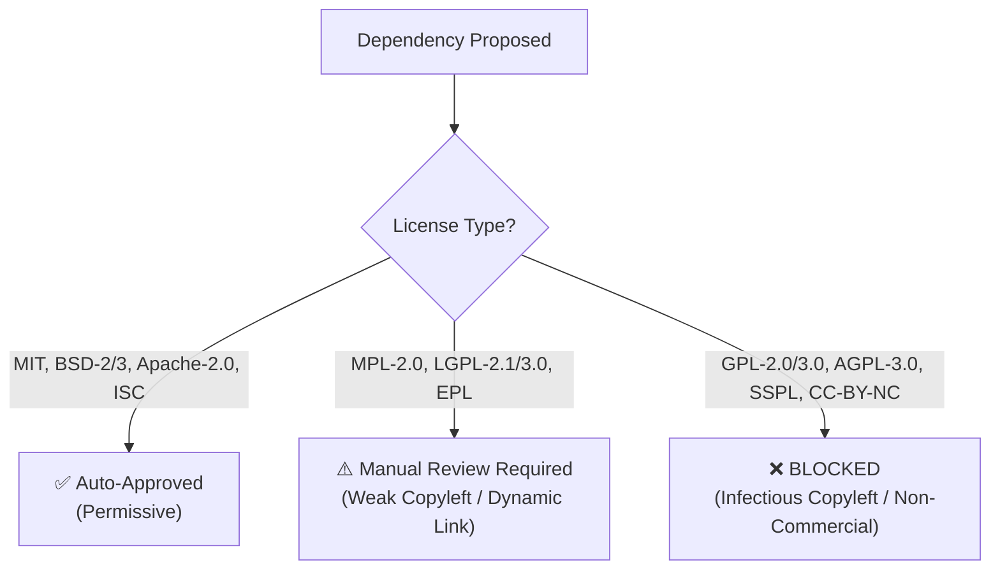

# Document Reviewer — Open-Source License Audit

## 1. Compliance Policy & Licensing Rules

To safeguard Document Reviewer against legal risk, license contamination, and proprietary encumbrances, all code and dependencies must adhere strictly to the following licensing tiers:

### 1.1 Category Tiers

| Tier | Licenses | Policy | Action |
|---|---|---|---|
| **Tier 1: Permissive** | MIT, BSD-2-Clause, BSD-3-Clause, Apache-2.0, ISC, Unlicense | **Auto-Approved** | Integrate directly. Include original copyright notice in third-party notices. |
| **Tier 2: Weak Copyleft** | MPL-2.0, LGPL-2.1, LGPL-3.0, CDDL, EPL | **Manual Legal Review** | Permitted only if dynamically linked (shared object `.so` or separate service boundary) and modifications to the library are isolated. Must not infect Document Reviewer code. |
| **Tier 3: Strong Copyleft & Proprietary** | GPL-2.0, GPL-3.0, AGPL-3.0, SSPL, Commons Clause, Non-Commercial | **STRICTLY BLOCKED** | **Zero tolerance.** Never import, link, or bundle into the application. |

---

## 2. Flutter & Dart Dependencies Audit (`pubspec.yaml`)

The following table tracks all Dart/Flutter production and development dependencies currently declared in `pubspec.yaml`:

| Package | Version | Type | License | Status | Notes |
|---|---|---|---|:---:|---|
| `flutter_riverpod` | `^2.6.1` | Production | MIT | ✅ Approved | State management engine |
| `riverpod_annotation` | `^2.6.1` | Production | MIT | ✅ Approved | State management annotations |
| `go_router` | `^14.6.2` | Production | BSD-3-Clause | ✅ Approved | Declarative navigation router |
| `drift` | `^2.22.1` | Production | MIT | ✅ Approved | SQLite ORM layer |
| `sqlite3_flutter_libs` | `^0.5.28` | Production | MIT | ✅ Approved | Native SQLite runtime bindings |
| `path_provider` | `^2.1.5` | Production | BSD-3-Clause | ✅ Approved | Device file system directories |
| `logging` | `^1.3.0` | Production | BSD-3-Clause | ✅ Approved | Diagnostic logging framework |
| `freezed_annotation` | `^2.4.4` | Production | MIT | ✅ Approved | Immutable state annotations |
| `json_annotation` | `^4.9.0` | Production | BSD-3-Clause | ✅ Approved | JSON serialization annotations |
| `intl` | `^0.19.0` | Production | BSD-3-Clause | ✅ Approved | Internationalization & date formatting |
| `uuid` | `^4.5.1` | Production | MIT | ✅ Approved | Unique identifier generator |
| `path` | `^1.9.1` | Production | BSD-3-Clause | ✅ Approved | Path manipulation utilities |
| `crypto` | `^3.0.3` | Production | BSD-3-Clause | ✅ Approved | PBKDF2 and SHA-256 for backup encryption & app lock |
| `very_good_analysis` | `^6.0.0` | Development | MIT | ✅ Approved | Strict static linting rules |
| `build_runner` | `^2.4.14` | Development | BSD-3-Clause | ✅ Approved | Code generation execution tool |
| `build_runner_core` | `^7.3.2` | Development | BSD-3-Clause | ✅ Approved | Code generation core subsystem |
| `drift_dev` | `^2.22.1` | Development | MIT | ✅ Approved | Database schema code generator |
| `freezed` | `^2.5.7` | Development | MIT | ✅ Approved | Immutable model code generator |
| `json_serializable` | `^6.9.2` | Development | BSD-3-Clause | ✅ Approved | JSON serialization code generator |
| `riverpod_generator` | `^2.6.3` | Development | MIT | ✅ Approved | Riverpod code generator |
| `mockito` | `^5.4.5` | Development | Apache-2.0 | ✅ Approved | Unit test mocking framework |

---

## 3. Native & C++ Dependencies (Android / JNI)

*This section tracks native Android and JVM libraries considered or integrated into `android/document_engine`.*

| Library / Component | Evaluated Version | Purpose | License | Status | Review Notes |
|---|---|---|---|:---:|---|
| `org.apache.poi:poi` | `5.3.0` | Office DOCX/XLSX manipulation | Apache-2.0 | ✅ Approved | Tier 1 Permissive. Verified in Spike A. |
| `org.apache.poi:poi-ooxml` | `5.3.0` | OOXML format parsing & serialization | Apache-2.0 | ✅ Approved | Tier 1 Permissive. Verified in Spike A. |
| `org.apache.xmlbeans:xmlbeans` | `5.2.1` | XML schema binding for OOXML | Apache-2.0 | ✅ Approved | Tier 1 Permissive. |
| `org.apache.commons:commons-compress` | `1.26.2` | Archive & ZIP compression for OOXML packages | Apache-2.0 | ✅ Approved | Tier 1 Permissive. |
| `org.apache.commons:commons-collections4`| `4.4` | Collection utilities for POI internal structures | Apache-2.0 | ✅ Approved | Tier 1 Permissive. |
| `com.tom-roush:pdfbox-android` | `2.0.27.0` | PDF text search, highlight & annotations | Apache-2.0 | ✅ Approved | Tier 1 Permissive. Verified in Spike B. Pure DEX (0 .so files, inherent 16 KB page compliance). |
| `android.graphics.pdf.PdfRenderer` | `API 21+` | Built-in hardware-accelerated PDF rendering | Apache-2.0 | ✅ Approved | OS built-in framework. |
| `com.quickbirdstudios:opencv` | `4.5.3.0` | Document edge detection & perspective warp | Apache-2.0 | ⚠️ Conditional | Tier 1 Permissive. Prebuilt AAR uses 4 KB alignment; production build requires NDK r27 16 KB page-size flag. |
| `cz.adaptech.tesseract4android` | `4.7.0` | Offline Tesseract 5.3 OCR engine | Apache-2.0 | ⚠️ Conditional | Tier 1 Permissive. Prebuilt AAR uses 4 KB alignment; production build requires NDK r27 16 KB page-size flag. |
| `Leptonica` | `1.82+` | Image processing library for Tesseract | BSD-2-Clause | ✅ Approved | Tier 1 Permissive. Bundled with Tesseract. |
| `tessdata_fast (eng + ind)` | `Latest` | Bundled offline neural language models | Apache-2.0 | ✅ Approved | Tier 1 Permissive. Bundled in `assets/ocr/`. |
| `LibreOfficeKit (LOKit)` | `7.x` | Embedded LibreOffice engine | MPL-2.0 / LGPLv3 | ❌ Rejected (NO-GO) | High build complexity, >180 MB .so files, license entanglement. |
| `MuPDF` | `1.x` | PDF rendering & annotation engine | AGPL-3.0 | ❌ Strictly Blocked | Violates Tier 3 policy (AGPL copyleft infection). |

### 3.1 Upcoming Native Candidate Review Queue
- **PDFium**: Apache-2.0 / BSD-3-Clause (Foxit/Google). Expected status: Auto-Approve.
- **OpenCV Android**: Apache-2.0 (OpenCV Foundation). Expected status: Auto-Approve.
- **Tesseract OCR & Leptonica**: Apache-2.0 (Tesseract) / BSD-2-Clause (Leptonica). Expected status: Auto-Approve.
- **Apache POI**: Apache-2.0 (Apache Software Foundation). Expected status: Auto-Approve.
- **LibreOffice / Collabora (LOKit)**: MPL-2.0. Requires strict isolation / dynamic linkage review under Tier 2.
