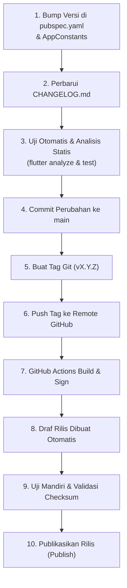

# Standar Operasional Prosedur (SOP) Rilis Aplikasi

Dokumen ini memuat panduan langkah-demi-langkah bagi pemelihara repositori untuk mempersiapkan, membangun, memvalidasi, dan menerbitkan rilis versi baru **Document Reviewer**.

---

## 1. Siklus Rilis Standar (Step-by-Step)



### Langkah 1: Kenaikan Versi (*Version Bump*)
1. Naikkan versi pada `pubspec.yaml` sesuai Semantic Versioning (SemVer):
   ```yaml
   version: 0.2.0+2
   ```
2. Sesuaikan konstanta versi di `lib/core/constants/app_constants.dart`:
   ```dart
   static const String appVersion = '0.2.0';
   ```

### Langkah 2: Pembaruan Catatan Perubahan (*CHANGELOG.md*)
Tambahkan entri baru di atas entri rilis sebelumnya pada berkas `CHANGELOG.md`:
```markdown
## [0.2.0] - YYYY-MM-DD

### Ditambahkan
- Fitur X...
### Diperbaiki
- Masalah Y...
```

### Langkah 3: Pengujian & Validasi Lokal
Pastikan repositori bersih dan lulus seluruh gate:
```bash
flutter analyze --no-pub
flutter test
```

### Langkah 4 & 5: Commit dan Buat Tag Git
```bash
git add pubspec.yaml lib/core/constants/app_constants.dart CHANGELOG.md
git commit -m "chore(release): bump version to v0.2.0"
git push origin main

# Buat tag beranotasi
git tag -a v0.2.0 -m "Release v0.2.0"
```

### Langkah 6 & 7: Trigger Alur Kerja CI
```bash
git push origin v0.2.0
```
GitHub Actions di `.github/workflows/release.yml` akan secara otomatis:
- Menjalankan analisis dan pengujian.
- Menandatangani APK dan AAB menggunakan rahasia GitHub Secrets.
- Memverifikasi sertifikat biner menggunakan `apksigner`.
- Menghasilkan berkas `SHA256SUMS.txt`.
- Membuat draf rilis (*Draft Release*).

### Langkah 8 & 9: Verifikasi Draf Rilis
1. Buka halaman Releases di GitHub.
2. Unduh berkas APK dan cocokkan nilai SHA-256 terhadap `SHA256SUMS.txt`.
3. Pasang di perangkat uji fisik untuk memastikan tidak ada regresi fungsi atau izin SAF.

### Langkah 10: Publikasi Rilis
1. Di halaman rilis GitHub, edit draf rilis tersebut.
2. Centang *"Set as the latest release"* (atau centang *"Set as a pre-release"* jika berstatus alpha/beta/rc).
3. Klik **"Publish release"**.

---

## 2. Rencana Pemulihan & Rollback (Mitigasi Bug Kritis)

Jika ditemukan masalah fatal atau regresi data (P0 Bug) setelah rilis dipublikasikan:
1. **Tandai Pre-Release / Hapus Aset Cacat**:
   - Buka halaman rilis yang bermasalah di GitHub, ubah statusnya menjadi *Pre-release* dengan peringatan keras pada judul rilis, atau hapus aset APK yang bermasalah dari rilis tersebut.
2. **Jangan Menggunakan Ulang Nomor Versi**:
   - Dilarang keras menimpa tag git atau merilis ulang dengan nomor versi atau versionCode yang sama. Android Package Manager akan menolak instalasi jika versionCode sama atau lebih rendah.
3. **Terbitkan Rilis Perbaikan Segera (*Hotfix*)**:
   - Buat branch perbaikan dari commit rilis sebelumnya.
   - Selesaikan masalah dan naikkan versionCode (misalnya dari `+2` menjadi `+3`, versi `0.2.1`).
   - Buat tag `v0.2.1` dan jalankan alur kerja rilis baru.
   - Berikan catatan transparan di `CHANGELOG.md` mengenai penyebab masalah dan mitigasi data pengguna.

---

## 3. Pertimbangan Distribusi Lanjutan (Roadmap Masa Depan)

*Catatan: Dokumen ini hanya memetakan pertimbangan, implementasi tidak dijalankan pada tahap ini.*

### A. F-Droid & IzzyOnDroid
- **Persyaratan**:
  - Seluruh kode dan dependensi harus 100% open-source dan dapat dibangun secara reproducible dari sumber (*reproducible builds*).
  - Tidak menyertakan binary blobs tak berlisensi.
  - Repositori harus memiliki tag git yang sesuai dengan versi rilis.
- **Langkah Lanjutan**: Mendaftarkan metadata resep build (`fdroiddata`) setelah versi stabil `v1.0.0` dirilis.

### B. Google Play Store
- **Persyaratan**:
  - Mengunggah Android App Bundle (`.aab`).
  - Mendaftarkan Play App Signing key di Google Play Console.
  - Melengkapi kuesioner **Data Safety** (100% no collection, no sharing).
  - Deklarasi izin non-internet dan kepatuhan terhadap Target SDK terbaru (SDK 35/36).

