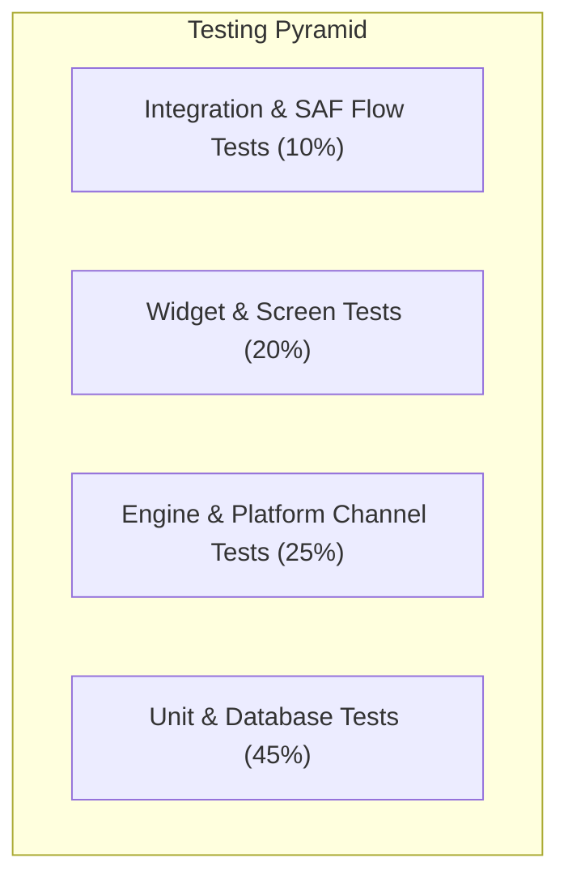

# Document Reviewer — Master Test Plan

## 1. Test Strategy & Quality Philosophy

Document Reviewer adheres to an offline-first, fail-safe testing philosophy. Because our application handles critical personal and professional user documents, test suites prioritize **data integrity**, **memory bounds**, and **crash prevention**.



### Coverage Targets
- **Domain & Business Logic**: >= 90% branch coverage.
- **Data & Repositories**: >= 85% coverage.
- **Engine Platform Channels**: 100% contract and error-handling coverage.
- **Overall Application Code**: >= 80% aggregate line coverage.

---

## 2. Unit Testing Strategy

Unit tests execute within the local Dart VM environment with zero emulator or hardware dependencies.

### 2.1 Domain Logic & Entities
- Validation of immutable models generated via `freezed`.
- Coordinate space calculations: Page-to-screen coordinate normalization, bounding box hit-testing for annotations.
- Geometry and math utilities for freehand ink smoothing and polygon simplify algorithms.

### 2.2 Database Operations (Drift / SQLite)
- Execute tests against an in-memory SQLite database instance (`NativeDatabase.memory()`).
- Verify database migrations across schema versions.
- Test cascading deletes: Ensuring deleting a recent document removes associated bookmarks and cached thumbnail references.
- Verify reactive queries: Ensuring `Stream` emissions fire accurately when recent files or bookmarks update.

### 2.3 Repositories
- Test repository business logic using `mockito` to stub platform channel adapters and database DAOs.
- Ensure proper error wrapping: Platform exceptions must be translated into typed domain failures (`DocumentNotFoundException`, `CorruptedFileException`, `PermissionDeniedException`).

### 2.4 Utility Functions
- File path normalization, extension parsing, and MIME-type detection.
- Human-readable file size formatters, date/time formatters, and color HEX conversions.
- SAF URI parsing and display name decoders.

---

## 3. Widget & UI Testing

Widget tests run headless using Flutter's `flutter_test` environment to validate UI behavior, component rendering, and user event handling.

### 3.1 Screen-Level Tests
- **Home Screen**:
  - Displays empty state illustrations when no recent documents exist.
  - Correctly populates recent file cards with titles, file sizes, and cached thumbnails.
  - Action buttons (Open Document, Camera Scan, Create Document) trigger expected navigation events.
- **Document Reader Screen**:
  - Page viewport accurately handles pagination and vertical scroll layouts.
  - Page indicator HUD appears during scrolling and auto-hides after the configured timeout.
  - Pinch-to-zoom gestures trigger viewport transform updates without layout overflow.
  - Outline/TOC drawer opens and clicking nodes triggers page jumps.
- **Editor Screens (Word & Spreadsheet)**:
  - Formatting toolbar toggles bold, italic, and alignment states accurately based on selection.
  - Spreadsheet grid updates cell text and recalculates dependent formula cells.
- **Scanner Viewfinder Screen**:
  - Displays quad-crop draggable handles when a document contour is detected.
  - Filter preview bar switches between original, Magic Color, and B&W modes.

### 3.2 Navigation & Routing
- Verify `go_router` navigates between routes with expected parameters.
- Verify deep links: Opening the app with an `ACTION_VIEW` intent loads the Document Reader with the provided URI.

### 3.3 Theme & Accessibility Switching
- Validate visual tree under Light, Dark, and High-Contrast modes.
- Verify minimum touch target sizes (>= 48x48 dp) and semantic labeling for screen readers.

---

## 4. Engine Interface & Platform Channel Tests

Native platform channels require strict testing to guarantee type safety and error propagation across the Dart-Kotlin boundary.

### 4.1 Mock Engine Implementations
Every engine interface defined in `lib/core/engine/` has a corresponding test mock:
- `MockDocumentReaderEngine`: Simulates page rendering by returning synthetic 100x100 colored bitmap bytes.
- `MockPdfAnnotationEngine`: Verifies annotation payloads are correctly serialized to byte arrays.
- `MockOfficeEditorEngine`: Simulates cell mutation and saves dummy OpenXML output.
- `MockOcrEngine`: Returns predefined text blocks with bounding boxes and confidence scores.
- `MockDocumentScannerEngine`: Returns predictable quad corner coordinates.

### 4.2 Platform Channel Codec Validation
- Test channel method dispatching: Verifies that method names, parameter keys, and data types match native expectations.
- Test platform error handling: Native `PlatformException` (e.g., password-protected PDF, out-of-memory) must map directly to Dart domain exceptions.
- Event channel stream tests: Verify listening, cancellation, and backpressure behavior during continuous camera frame processing.

---

## 5. Integration & SAF Flow Testing

Integration tests execute on an Android emulator (API 26 and API 35) or real hardware using `integration_test`.

### 5.1 Storage Access Framework (SAF) Workflow
1. Trigger `ACTION_OPEN_DOCUMENT` picker mock.
2. Grant persistable URI permission (`takePersistableUriPermission`).
3. Verify that app restart retains access to the persisted URI without prompting the user.
4. Test permission revocation handling when a user deletes or moves the external file outside the app.

### 5.2 Document Open-to-Save Lifecycle
1. Pick test document from assets/fixtures.
2. Stage file into private scratch cache (`/cache/scratch/<session_id>/`).
3. Render first 5 pages and extract text outline.
4. Apply an ink annotation and a text highlight.
5. Trigger save operation.
6. Verify atomic write back to original target URI.
7. Re-read target file to confirm annotations are embedded into the native PDF specification.

---

## 6. Performance & Benchmark Testing

Performance benchmarks run using Flutter Driver and Android Profile tools on a low-end test device (e.g., Android 8.0, 2GB RAM).

| Benchmark Metric | Target Threshold | Test Procedure |
|---|---|---|
| **Document Open Time** | < 1.0s (10MB PDF)<br>< 3.0s (50MB PDF / 10-page DOCX) | Time elapsed from file selection to first page rasterized on screen. |
| **Page Rasterization Speed** | < 100ms per page | Time to decode vector PDF page into 1080p `Bitmap` at 1.0x scale. |
| **Scrolling Frame Rate** | >= 58 FPS (target 60 FPS) | Smooth continuous fling scrolling through 100-page document. |
| **Peak Memory Consumption** | < 200MB (PDF)<br>< 250MB (Office DOCX/XLSX) | Measured using Android Studio Memory Profiler during 30-minute reading session. |
| **Memory Reclamation** | 100% garbage collected | All page bitmaps and cached native handles must release upon closing viewer. |
| **OCR Processing Speed** | < 4.0s per page | Full-page 300 DPI text recognition using Indonesian/English Tesseract model. |

---

## 7. Manual Test Checklist: Edit Verification Cycle

Before any release build, the following destructive and edge-case manual tests must be performed:

- [ ] **Standard Save Cycle**: Modify DOCX/XLSX file -> Save -> Inspect SHA-256 of output -> Verify file opens in Microsoft 365, LibreOffice, and Google Docs without warnings.
- [ ] **Interrupted Save (Process Kill)**: Initiate save on large 50MB document -> Force-kill app (`am force-stop`) mid-write -> Re-launch app -> Verify original file is 100% intact and uncorrupted.
- [ ] **Low Storage / Disk Full**: Simulate low disk space (< 5MB available) -> Attempt save -> App must cleanly fail with "Insufficient storage" alert and leave original file untouched.
- [ ] **Read-Only File URI**: Open document from read-only SAF provider -> Attempt edit -> App must prompt user to "Save As a Copy" instead of crashing or attempting illegal overwrite.
- [ ] **Simultaneous Access**: Open document -> Modify external document via third-party file manager -> Save in Document Reviewer -> App must detect file conflict and prompt for resolution.

---

## 8. Test Fixtures Plan

Test fixtures are stored in the `test/fixtures/` directory, tracked via Git LFS where necessary:

```
test/fixtures/
├── pdf/
│   ├── minimal_1_page.pdf           # 1-page standard text PDF
│   ├── complex_vector_100_pages.pdf # High-density architectural schematics
│   ├── form_fillable.pdf            # PDF with interactive AcroForms
│   ├── encrypted_aes256.pdf         # Password-protected document ("password123")
│   ├── corrupted_truncated.pdf      # PDF missing EOF marker and cross-reference table
│   └── linearised_web_optimized.pdf # Fast web view PDF
├── office/
│   ├── standard_sample.docx         # Text, nested tables, headers, embedded PNG
│   ├── legacy_word_format.doc       # Binary format (for testing rejection/conversion)
│   ├── multi_sheet_calc.xlsx        # 5 sheets, formulas (SUM, AVG), cell styling
│   └── presentation_sample.pptx     # 10 slides with shapes and bullet points
├── images/
│   ├── camera_receipt_skewed.jpg    # Skewed receipt on dark desk for scanner testing
│   ├── document_shadows.png         # Document with heavy finger and ambient shadows
│   └── low_light_text.jpg           # High noise, low contrast text photo
└── ocr/
    ├── indonesian_newspaper_clip.png# Clean Indonesian printed text
    └── english_invoice_sample.png   # Mixed tabular English invoice
```


---

## 9. Tahap 2 — Application Foundation Test Suite

### 9.1 Implemented Unit & Widget Tests
The following test suites validate the core application foundation without emulator dependencies:

| Test File | Test Cases | Validation Focus |
|---|---|---|
| `test/unit/database_migration_test.dart` | 2 | Schema v2 initialization; v1 $\to$ v2 migration with dynamic index creation (`document_records_fav_idx`, `recent_documents_opened_at_idx`). |
| `test/unit/save_coordinator_test.dart` | 8 | Working copy isolation; dirty state persistence; atomic save with Drift version logging; failure modes (missing working copy, 0-byte corrupted file, revoked SAF permission, write failure); Save As target switching; process death recovery of uncommitted dirty sessions. |
| `test/unit/storage_directory_manager_test.dart` | 3 | Sandboxed directory creation and separation (`working/`, `temp/`, `export/`); filename sanitization (illegal characters `:*?"<>\|`); age-based cache cleanup. |
| `test/unit/engine_impl_test.dart` | 5 | Contract validation and channel serialization for `NativeDocumentReaderEngine`, `NativeOfficeEditorEngine`, `NativePdfAnnotationEngine`, `NativeDocumentScannerEngine`, `NativeOcrEngine`. |
| `test/unit/saf_file_service_test.dart` | 2 | Deserialization of SAF picker results and fallback handling for missing metadata. |
| `test/unit/exceptions_test.dart` | 4 | Exhaustive pattern matching across all sealed `DocumentEngineException` subtypes (`DocumentNotFoundException`, `DocumentEncryptedException`, `DocumentCorruptedException`, `UnsupportedFormatException`, `DocumentSaveException`, `EngineNotInitializedException`, `ResourceLimitException`, `DocumentRenderException`, `StoragePermissionException`). |
| `test/widget/home_screen_test.dart` | 5 | Adaptive layout widget rendering; localized strings (English & Indonesian); empty state placeholders; favorite and recent section headers; settings action dispatch. |

### 9.2 CI & 16 KB Memory Page Alignment
- GitHub Actions CI executes on every push and pull request to `main`:
  1. `flutter analyze --fatal-infos --fatal-warnings`
  2. `flutter test --coverage`
  3. `flutter build apk --debug --split-per-abi`
  4. Python ELF audit on all APK `.so` libraries to assert `PT_LOAD` memory alignment $\ge 16\text{ KB}$ for 64-bit binaries.

---

## 10. Tahap 4 — PDF Tools Test Suite

### 10.1 Implemented Unit & Widget Tests
The PDF Tools suite verifies all annotation modes, page manipulation operations, undo/redo mechanisms, and error recovery:

| Test File | Test Cases | Validation Focus |
|---|---|---|
| `test/unit/tahap4_pdf_tools_test.dart` | 12 | `PdfAnnotationController` undo/redo stack; draft serialization & process death recovery; `NativePdfAnnotationEngine` platform channel method dispatches (highlight, underline, pen, text, signature); `NativePdfPageEngine` page rotation, deletion, reordering, merging, splitting; missing file exception handling; 500-page simulated memory stability test. |
| `test/widget/pdf_tools_widget_test.dart` | 6 | `SignatureDialog` statutory disclaimer display (*"Ini BUKAN tanda tangan elektronik tersertifikasi"*); freehand signature canvas drawing & clear; `PdfToolsBottomBar` tool selection & mode switching; `PdfPageManagerScreen` rotation & deletion prevention when <= 1 page remaining; `PdfSplitDialog` page range validation; `PdfMergeDialog` file list display. |

---

## 11. Tahap 5 — Office Editor Test Suite

### 11.1 Implemented Unit & Widget Tests
The Office Editor suite verifies Apache POI structured DOCX editing, multi-sheet XLSX manipulation, formula editing, undo/redo mechanisms, and the mandatory edit verification cycle:

| Test File | Test Cases | Validation Focus |
|---|---|---|
| `test/unit/tahap5_office_editor_test.dart` | 10 | `OfficeEditorController` DOCX block mutators (paragraphs, headings, tables, breaks) & undo/redo; XLSX spreadsheet mutators (cell values, formulas, bold/italic, sheet add/rename, row add/delete) & undo/redo; JSON draft autosave & process death recovery; `NativeOfficeEditorEngine` platform channel dispatches; ZIP schema validation; Mandatory Edit Verification Cycle on `synth_simple.docx` and `synth_simple.xlsx` (100% byte preservation of original source files, save failure on invalid destination). |
| `test/widget/office_editor_widget_test.dart` | 5 | `DocxEditorWidget` rendering headings, paragraphs, tables, and quick action bar; `XlsxEditorWidget` rendering multi-sheet tabs, formula bar (`fx`), and cell selection; `OfficeAdaptiveToolbar` responsive layout (tablet ribbon >= 600dp vs mobile bottom bar < 600dp); `OfficeKeyboardShortcuts` (`Ctrl+Z`, `Ctrl+Y`, `Ctrl+S`). |

---

## 12. Tahap 6 — Scanner & OCR Test Suite

### 12.1 Implemented Unit & Widget Tests
The Scanner & OCR suite validates edge detection, perspective transformation, image enhancement filters, offline Tesseract OCR text extraction, searchable PDF generation, and multi-page queue management:

| Test File | Test Cases | Validation Focus |
|---|---|---|
| `test/unit/tahap6_scanner_ocr_test.dart` | 14 | `NativeDocumentScannerEngine` edge detection, corner ordering, perspective warping, filter application (grayscale, B&W, contrast, original), page rotation, multi-page PDF generation; `NativeOcrEngine` offline Indonesian/English text recognition, bounding box detection, searchable PDF generation; `ScannerController` multi-page state management, quad adjustment, page reordering, downsampling on memory pressure. |
| `test/widget/scanner_ocr_widget_test.dart` | 12 | `DocumentScannerScreen` tool bar, camera fallback, gallery import; `QuadCropOverlay` 4 draggable corner handles, boundary constraints; `FilterSelectorBar` filter modes (Magic Color, B&W, Grayscale, Original); `OcrResultSheet` copy-to-clipboard, text editing, language selector; export quality settings dialog. |

---

## 13. Tahap 7 — Backup, Keamanan, & Polish Test Suite

### 13.1 Implemented Unit & Widget Tests
The Backup, Security, and Polish suite validates end-to-end data export/restore, password-based AES encryption with PBKDF2 key derivation, schema versioning, biometric & PIN app lock, `FLAG_SECURE` platform channel, secure cache wipe, and UI/UX accessibility:

| Test File | Test Cases | Validation Focus |
|---|---|---|
| `test/unit/tahap7_backup_security_test.dart` | 10 | `BackupService` unencrypted/encrypted archive creation, PBKDF2 + AES stream encryption, wrong password rejection (`InvalidBackupPasswordException`), schema version checks (`UnsupportedBackupVersionException`), full database restoration into clean install; `AppLockService` numeric PIN hashing (SHA-256 + salt), verification, biometric toggle, background auto-lock, `FLAG_SECURE` screenshot blocking; `SecureWipeService` temporary file cleanup and full database/credential wipe; 100% offline manifest audit (no `INTERNET` permission, documented `USE_BIOMETRIC`). |
| `test/widget/tahap7_backup_security_widget_test.dart` | 8 | `OnboardingScreen` 3-step walkthrough navigation, finish & skip actions; `AppLockScreen` numeric keypad PIN entry, incorrect PIN feedback, biometric trigger; `BackupRestoreScreen` export & restore UI cards, document inclusion switch, password encryption toggle; `AboutScreen` version display, privacy policy card, third-party licenses tile; `SettingsScreen` security, backup, secure wipe, and theme selection tiles. |


